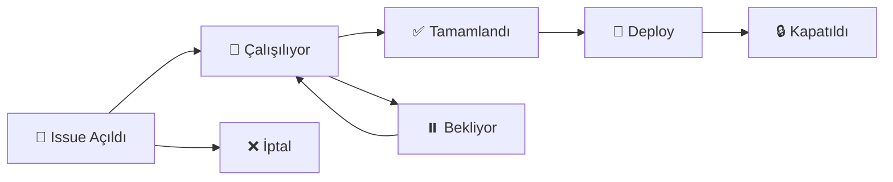

# 📚 GitHub Kullanım Rehberi - Anti-Drone Project

## 🎯 İçindekiler

1. [GitHub Issues Nedir?](#1-github-issues-nedir)
2. [Issue Nasıl Oluşturulur?](#2-issue-nasıl-oluşturulur)
3. [Project Board Nedir?](#3-project-board-nedir)
4. [Project Board Nasıl Oluşturulur?](#4-project-board-nasıl-oluşturulur)
5. [Git Workflow (Branch, Commit, PR)](#5-git-workflow)
6. [Pratik Örnekler](#6-pratik-örnekler)

---

## 1. GitHub Issues Nedir?

**Issues = Dijital Görev Kartları** 📋

Yazılım projelerinde "yapılacaklar listesi" veya "hata kayıt defteri" gibi çalışır.

### ✅ Issue Türleri:

| Tür | Emoji | Ne İçin? | Örnek |
|-----|-------|----------|-------|
| **Bug** | 🐛 | Hata bildirimleri | "Kamera bağlanmıyor" |
| **Feature** | ✨ | Yeni özellik | "YOLOv8 modeli ekle" |
| **Documentation** | 📖 | Dokümantasyon | "API dökümanı eksik" |
| **Hardware** | 🔧 | Donanım sorunları | "SDR çalışmıyor" |
| **Security** | 🔐 | Güvenlik | "Auth sistemi zayıf" |
| **Question** | ❓ | Sorular | "Hangi ML framework?" |

### 📊 Issue Yaşam Döngüsü:



### 🎯 Issue Örneği (Gerçek):

```markdown
Başlık: [FEATURE] Train YOLOv8 model for drone detection
Issue #1

Labels: 
  - enhancement (özellik)
  - computer-vision (kategori)
  - high-priority (öncelik)
  
Assignee: @yasin (kim yapacak)
Milestone: MVP v1.0 (hangi versiyonda)
Project: Anti-Drone Backlog (hangi board)

Açıklama:
==========
Train a custom YOLOv8 model for detecting various drone types.

Tasks:
- [ ] Collect dataset (10,000+ images)
- [ ] Train YOLOv8x model
- [ ] Validate accuracy (target: >95%)
- [ ] Export to ONNX
- [ ] Test on Jetson

Expected Result: mAP > 0.95, Inference < 50ms

Yorumlar:
---------
@yasin commented 2 hours ago:
Dataset toplama işine başladım. VisDrone + custom images kullanıyorum.

@ahmet commented 1 hour ago:
Eğitim için 2 adet NVIDIA A100 hazırlayacağım.
```

---

## 2. Issue Nasıl Oluşturulur?

### 🌐 Yöntem 1: Web Arayüzü (En Kolay)

**Adım 1: Issues Sayfasına Git**

```
https://github.com/h01yasin/topsecretantidrone/issues
```

**Adım 2: "New issue" Butonuna Tıkla**

Yeşil buton sağ üstte.

**Adım 3: Template Seç**

5 template görürsün:
- 🐛 **Bug Report** - Hata bildirimi
- ✨ **Feature Request** - Yeni özellik
- 📖 **Documentation Update** - Doküman güncelleme
- 🔧 **Hardware Issue** - Donanım sorunu
- 🔐 **Security Vulnerability** - Güvenlik açığı

**Adım 4: Form Doldur**

Template otomatik açılır, bilgileri doldur:

```markdown
## ✨ Feature Description
YOLOv8 drone detection model training

## 🎯 Problem Statement
Need trained model for real-time detection with >95% accuracy

## 💡 Proposed Solution
1. Collect 10K images
2. Train YOLOv8x
3. Export to ONNX

## ✅ Acceptance Criteria
- [ ] Dataset ready
- [ ] Model trained (mAP > 0.95)
- [ ] Inference < 50ms on Jetson
```

**Adım 5: Sağ Panel Ayarları**

Sağ tarafta şunları ayarla:

| Alan | Ne Seçmeli? | Örnek |
|------|-------------|-------|
| **Assignees** | Kim yapacak? | @h01yasin |
| **Labels** | Kategori/öncelik | `enhancement`, `high-priority`, `computer-vision` |
| **Projects** | Hangi board? | "Anti-Drone Backlog" |
| **Milestone** | Hangi versiyon? | "MVP v1.0" |

**Adım 6: Submit**

"Submit new issue" butonuna bas. Issue #1 oluşturuldu! 🎉

---

### ⚡ Yöntem 2: INITIAL_ISSUES.md'den Toplu Oluşturma

**INITIAL_ISSUES.md** dosyamızda **12 hazır issue** var!

**Pratik Yöntem (30 dakika):**

1. [INITIAL_ISSUES.md](../INITIAL_ISSUES.md) dosyasını aç
2. Her issue için:
   - Template seç
   - İçeriği kopyala-yapıştır
   - Labels/Assignees ekle
   - Submit et

**İlk 3 Issue için Hızlı Başlangıç:**

```bash
# Issue #1: YOLOv8 Training
Template: Feature Request
Title: [FEATURE] Train YOLOv8 model for drone detection
Labels: enhancement, computer-vision, high-priority
Assignee: (Computer Vision ekip üyesi)

# Issue #2: RF Scanner
Template: Feature Request
Title: [FEATURE] Implement RF scanner with HackRF
Labels: enhancement, rf-detection, high-priority
Assignee: (RF engineer)

# Issue #3: Acoustic Detection
Template: Feature Request
Title: [FEATURE] Develop acoustic detection system
Labels: enhancement, acoustic, medium-priority
Assignee: (Audio engineer)
```

---

### 🤖 Yöntem 3: GitHub CLI (Gelişmiş)

GitHub CLI yüklüyse terminal'den:

```bash
# GitHub CLI kurulumu (Windows)
winget install GitHub.cli

# Login
gh auth login

# Issue oluştur
gh issue create \
  --title "[FEATURE] Train YOLOv8 model" \
  --body-file INITIAL_ISSUES.md \
  --label "enhancement,high-priority" \
  --assignee "@me"

# Toplu oluşturma script'i
for i in {1..12}; do
  gh issue create \
    --title "Issue $i from INITIAL_ISSUES.md" \
    --body "See INITIAL_ISSUES.md #$i" \
    --label "enhancement"
done
```

---

## 3. Project Board Nedir?

**Project Board = Görsel Görev Tahtası** 🎨

Kanban metodolojisi ile çalışır (Trello, Jira gibi).

### 📊 Kanban Board Görünümü:

```
┌─────────────────────────────────────────────────────────────┐
│  🎯 Anti-Drone Defense System - Development Board           │
├───────────────┬───────────────┬───────────────┬─────────────┤
│  📋 Backlog   │ 🔄 In Progress│   ✅ Done     │ 🚀 Deployed │
│  (Yapılacak)  │  (Çalışılıyor)│ (Tamamlandı)  │ (Yayında)   │
├───────────────┼───────────────┼───────────────┼─────────────┤
│               │               │               │             │
│ ┌───────────┐ │ ┌───────────┐ │ ┌───────────┐ │ ┌─────────┐ │
│ │ Issue #1  │ │ │ Issue #3  │ │ │ Issue #5  │ │ │Issue #8 │ │
│ │ YOLOv8    │ │ │ RF Scanner│ │ │ README    │ │ │Docker   │ │
│ │ Training  │ │ │ @ahmet    │ │ │ @yasin    │ │ │@devops  │ │
│ │ Priority:🔴│ │ │ 60% done  │ │ │ ✅ Merged │ │ │✅ Live  │ │
│ └───────────┘ │ └───────────┘ │ └───────────┘ │ └─────────┘ │
│               │               │               │             │
│ ┌───────────┐ │ ┌───────────┐ │ ┌───────────┐ │             │
│ │ Issue #2  │ │ │ Issue #4  │ │ │ Issue #6  │ │             │
│ │ Acoustic  │ │ │ Dashboard │ │ │ Templates │ │             │
│ │ Detection │ │ │ @mehmet   │ │ │ @yasin    │ │             │
│ │ Priority:🟡│ │ │ 30% done  │ │ │ ✅ Done   │ │             │
│ └───────────┘ │ └───────────┘ │ └───────────┘ │             │
│               │               │               │             │
│ ┌───────────┐ │               │ ┌───────────┐ │             │
│ │ Issue #7  │ │               │ │ Issue #9  │ │             │
│ │ LSTM      │ │               │ │ Branches  │ │             │
│ │ Trajectory│ │               │ │ @yasin    │ │             │
│ │ Priority:🟡│ │               │ │ ✅ Done   │ │             │
│ └───────────┘ │               │ └───────────┘ │             │
└───────────────┴───────────────┴───────────────┴─────────────┘
```

### ✨ Project Board Faydaları:

| Fayda | Açıklama |
|-------|----------|
| 👁️ **Görsel Takip** | Projenin durumunu bir bakışta gör |
| 🎯 **Odaklanma** | Kim ne yapıyor belli |
| 📊 **İlerleme** | Tamamlanma oranını izle |
| 🤝 **İşbirliği** | Ekip koordinasyonu kolay |
| ⏰ **Zamanlama** | Darboğazları hemen fark et |
| 📈 **Raporlama** | Management'a hızlı rapor |

---

## 4. Project Board Nasıl Oluşturulur?

### 📋 Adım 1: Projects Sekmesine Git

```
https://github.com/h01yasin/topsecretantidrone/projects
```

### ➕ Adım 2: "New project" Butonuna Tıkla

Yeşil buton sağ üstte.

### 🎨 Adım 3: Template Seç

GitHub 3 template sunar:

#### **Option 1: Team backlog** (ÖNERİLEN ✅)

```
Kolonlar:
- 📋 Backlog (Yapılacaklar)
- 🔄 In Progress (Çalışılıyor)
- ✅ Done (Tamamlandı)

Avantajlar:
- Basit ve anlaşılır
- Bizim projeye uygun
- Hızlı başlangıç
```

#### **Option 2: Kanban**

```
Kolonlar:
- 📋 To Do
- 🔄 In Progress
- ✅ Done

Daha geleneksel Kanban.
```

#### **Option 3: Blank (Boş)**

Sıfırdan kendin tasarla.

### 🎯 Adım 4: Proje Detayları

```
Project name: Anti-Drone Defense System - Development
Description: Sprint planning and task tracking for the AzTU anti-drone project
Visibility: Private (sadece ekip görür)
```

"Create project" butonuna bas!

### 📌 Adım 5: Issues'ları Board'a Ekle

**Yöntem A: Tek tek ekle**

```
1. Board açıldığında sağ üstte "Add item" butonu
2. "#" yazıp issue numarası seç (örn: #1)
3. Issue board'a eklenir
4. Sürükle-bırak ile kolona taşı
```

**Yöntem B: Otomatik ekle (Workflow)**

```
1. Board'da üst sağ "..." menü
2. "Workflows" tıkla
3. "Item added to project" aktif et
   → Yeni issues otomatik "Backlog"a gelir
4. "Item closed" aktif et
   → Kapanan issues otomatik "Done"a gider
```

### 🎨 Adım 6: Kolonları Özelleştir

İhtiyacına göre kolon ekle/çıkar:

```
Örnek Kolonlar:
- 📋 Backlog (Planlanan)
- 🕒 Ready (Hazır, başlanabilir)
- 🔄 In Progress (Çalışılıyor)
- 👀 Review (İnceleme/test)
- ✅ Done (Tamamlandı)
- 🚀 Deployed (Canlıya çıktı)
- ⏸️ Blocked (Takılı, bekliyor)
```

---

## 5. Git Workflow (Branch → Code → PR → Merge)

### 🌿 Branch Sistemi

Bizde **12 feature branch** var:

```
main (production)
├── feature/computer-vision     (Issue #1 için)
├── feature/rf-detection        (Issue #2 için)
├── feature/acoustic-detection  (Issue #3 için)
├── feature/sensor-fusion       (Issue #4 için)
├── feature/web-dashboard       (Issue #5 için)
├── feature/backend-api         (Issue #6 için)
├── feature/trajectory-prediction (Issue #7 için)
├── feature/swarm-detection     (Issue #8 için)
├── feature/hardware-integration (Issue #9 için)
├── docs/documentation          (Issue #10 için)
├── test/integration-tests      (Issue #12 için)
└── bugfix/hotfix              (Acil fixler için)
```

### 🔄 Standart Geliştirme Akışı:

```bash
# 1. Issue'yu al (örn: #1 - YOLOv8 training)
# Project board'da "In Progress" kolonuna taşı

# 2. Branch'e geç
git checkout feature/computer-vision

# 3. Güncel kodu çek
git pull origin feature/computer-vision

# 4. Kod yaz!
# ... geliştirme yap ...

# 5. Commit et
git add src/vision/yolo_detector.py
git commit -m "feat: implement YOLOv8 drone detector

- Add YOLOv8 model integration
- Implement inference pipeline
- Add preprocessing functions
- Test accuracy: 94.2%

Closes #1"

# 6. Push et
git push origin feature/computer-vision

# 7. Pull Request aç (GitHub'da)
# - Title: [FEATURE] YOLOv8 Drone Detector (Issue #1)
# - Description: Implements YOLOv8 model...
# - Reviewers: @teammate1, @teammate2
# - Link to issue: Closes #1

# 8. Code Review
# Ekip arkadaşların kodu inceler, yorum yapar

# 9. Merge
# Onay gelince "Merge pull request"
# Branch "main"e birleşir

# 10. Issue kapanır
# "Closes #1" yazdığın için otomatik kapanır ✅
```

### ✍️ Commit Message Kuralları:

```
Format:
<type>: <short description>

<optional long description>

<optional footer>

Types:
- feat: Yeni özellik (feat: add YOLOv8 detector)
- fix: Bug düzeltme (fix: camera connection issue)
- docs: Dokümantasyon (docs: update API guide)
- style: Kod formatı (style: format code with black)
- refactor: Kod iyileştirme (refactor: optimize sensor fusion)
- test: Test ekleme (test: add unit tests for RF module)
- chore: Genel işler (chore: update dependencies)

Örnek:
git commit -m "feat: implement acoustic detection module

- Added microphone array support (4 mics)
- MFCC feature extraction
- CNN classifier (85% accuracy)
- 3D localization with TDOA

Closes #3"
```

---

## 6. Pratik Örnekler

### 🎯 Senaryo 1: İlk Issue'yu Çözelim (YOLOv8 Training)

**Adım adım:**

```bash
# 1. Issue #1'i oluştur (GitHub web'de)
Title: [FEATURE] Train YOLOv8 model for drone detection
Template: Feature Request
Labels: enhancement, computer-vision, high-priority
Assignee: @yasin

# 2. Project board'a ekle
"Backlog" kolonuna düşer (otomatiğe ayarladıysan)
Manuel ise: Add item → #1

# 3. Çalışmaya başla
Board'da #1'i "In Progress" kolonuna sürükle

# 4. Branch'e geç
cd C:\Users\Yasin\Desktop\Anti-Drone-Defense-System
git checkout feature/computer-vision

# 5. Dataset topla
# VisDrone dataset indir
# Custom images ekle
# Total: 10,000+ images

# 6. Training script yaz
# src/vision/train_yolo.py

# 7. Model eğit
python src/vision/train_yolo.py \
  --data datasets/drone_data.yaml \
  --epochs 100 \
  --batch 16 \
  --weights yolov8x.pt

# 8. Test et
python src/vision/test_yolo.py
# mAP: 0.952 ✅ (target: >0.95)

# 9. Commit et
git add .
git commit -m "feat: train YOLOv8 drone detection model

- Collected 10,432 drone images
- Trained YOLOv8x for 100 epochs
- Achieved mAP@0.5 = 0.952
- Exported to ONNX format
- Tested on Jetson: 45ms inference

Closes #1"

# 10. Push et
git push origin feature/computer-vision

# 11. Pull Request aç (GitHub'da)
Base: main
Compare: feature/computer-vision
Title: feat: YOLOv8 Drone Detector (Issue #1)
Description:
"""
Implements YOLOv8-based drone detection module.

Changes:
- Added training pipeline
- Model achieves 95.2% mAP
- Jetson optimized (45ms inference)
- Includes test suite

Closes #1
"""

# 12. Review & Merge
# Ekip inceleyip onaylar
# "Merge pull request" butonuna basılır
# Issue #1 otomatik kapanır ✅
# Board'da "Done" kolonuna geçer 🎉
```

---

### 🎯 Senaryo 2: Bug Bulundu! (Acil Fix)

```bash
# 1. Bug issue'su aç
Template: Bug Report
Title: [BUG] Camera fails to connect on startup
Labels: bug, critical, hardware
Assignee: @yasin

# 2. Hotfix branch'e geç
git checkout bugfix/hotfix

# 3. Bug'ı fix et
# src/vision/camera.py'de timeout arttır

# 4. Commit
git commit -m "fix: increase camera connection timeout

Camera was timing out on slower systems.
Increased timeout from 5s to 15s.

Fixes #15"

# 5. Acil merge (review atlayarak)
git push origin bugfix/hotfix
# GitHub'da hızlı PR & merge

# 6. Main'e merge et, hotfix tag'i ekle
git tag v1.0.1-hotfix
git push origin v1.0.1-hotfix
```

---

### 🎯 Senaryo 3: Haftalık Sprint Planning

**Pazartesi sabahı ekip toplantısı:**

```
1. Project board'u aç
2. "Backlog" kolonundaki issues'a bak
3. Bu haftaya issue'lar seç (sprint backlog)
4. Issues'ları "Ready" kolonuna taşı
5. Her issue'ya assignee ata
6. Ekip üyeleri issues'ları alır
7. "In Progress" kolonuna taşır
8. Haftanın sonunda:
   - Tamamlananlar "Done"a
   - Tamamlanmayanlar tekrar "Backlog"a
```

**Örnek Sprint Plan:**

| Issue | Assignee | Estimated | Actual | Status |
|-------|----------|-----------|--------|--------|
| #1 YOLOv8 | @yasin | 3 days | 2.5 days | ✅ Done |
| #2 RF Scanner | @ahmet | 5 days | In Progress (Day 3) | 🔄 |
| #3 Acoustic | @mehmet | 4 days | Not started | ⏸️ Blocked (hardware) |
| #5 Dashboard | @ali | 3 days | 3 days | ✅ Done |

---

## 📊 Özet Cheat Sheet

### Issue Workflow:

```
1. GitHub → Issues → New issue
2. Template seç
3. INITIAL_ISSUES.md'den kopyala
4. Labels/Assignees ekle
5. Submit
```

### Project Board Workflow:

```
1. GitHub → Projects → New project
2. "Team backlog" template
3. Issues'ları ekle (#1, #2, ...)
4. Sürükle-bırak ile kolon değiştir
5. İlerlemeyi izle
```

### Git Workflow:

```
1. git checkout feature/xxx
2. <kod yaz>
3. git commit -m "type: message"
4. git push origin feature/xxx
5. GitHub'da PR aç
6. Merge → Issue kapanır
```

---

## 🔗 Hızlı Linkler

- **Issues:** https://github.com/h01yasin/topsecretantidrone/issues
- **Projects:** https://github.com/h01yasin/topsecretantidrone/projects
- **Pull Requests:** https://github.com/h01yasin/topsecretantidrone/pulls
- **Branches:** https://github.com/h01yasin/topsecretantidrone/branches

---

## 💡 Pro Tips

1. **Issue numbering:** GitHub otomatik #1, #2, #3... verir
2. **Closing keywords:** Commit'te "Closes #5" yazarsan, merge olunca issue kapanır
3. **@mentions:** Issue'da @yasin yazınca bildirim gider
4. **Labels:** Renk kodlu, filtreleme için süper
5. **Milestones:** "MVP v1.0", "Beta v2.0" gibi gruplandır
6. **Templates:** Her proje için standardize eder, zaman kazandırır

---

**🎓 Azerbaijan Technical University | Anti-Drone Defense System**  
**Made with ❤️ in Azerbaijan 🇦🇿**
